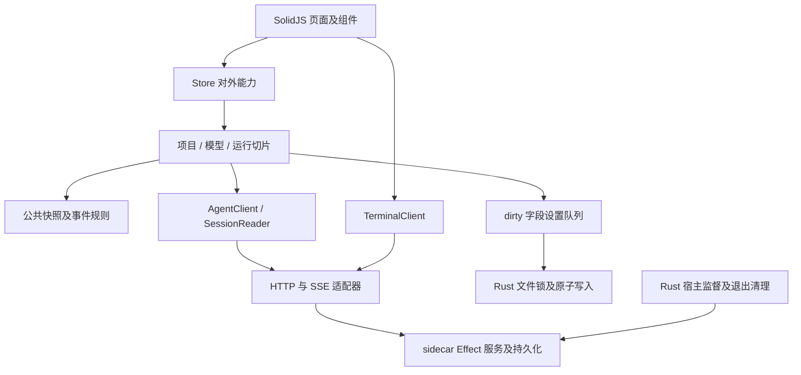

# Coda 架构优化实施结果

本轮保留产品行为、HTTP/SSE 协议及 1.5.2 版本。本文及机器记录保留架构验收时的状态；后续已按用户要求安装并微调新会话图标，现按用户要求提交全部源码（不推送或发布）。改造前诊断与工作区记录见 [基线报告](2026-10-18.md) 和 [历史证据](evidence.json)。已有 managed-terminals 后端改动完整保留。

## 原始问题与复审结论

整体分层合理，已补齐本轮确认的发布一致性、并发状态和持久化问题。设计以组合、响应式状态与 Effect 服务为主，适合现有技术栈。不能用类或模式数量证明优秀，也不能由一次审查保证没有未知问题。当前具备更明确的端口、共享规则及可重复的本地质量门禁；跨平台运行证据仍有限。

| 维度 | 复审 | 证据及边界 |
|---|---|---|
| 职责、内聚、可维护性 | 合格 | 公共快照管线集中规则，配置同步独立；AppProvider 仍是组合根，尚非所有状态的封装容器 |
| 单一职责 SRP | 合格 | 终端订阅、配置重试、原子设置写入从 UI/组合根移到专门模块 |
| 开闭 OCP、依赖倒置 DIP | 合格 | AgentClient、SessionReader、TerminalClient 为明确结构接口，可替换测试实现 |
| 接口隔离 ISP | 合格 | 快照与配置只接收所需状态和端口，不依赖完整客户端实现 |
| 里氏替换 LSP | 不适用继承审查 | 无业务继承体系；结构接口与实际行为由测试验证，不人为增加继承 |
| 模式与复杂度 | 合格 | 适配器、组合根、请求代次及有界重试有实际用途，无需再引入通用框架 |
| 无效代码 | 确认项已清理 | 保留动态高亮样式、兼容入口、平台条件代码和上游未使用包 |

## 修复对照

| 发现 | 实施 | 验证 |
|---|---|---|
| A01 干净发布源码缺终端补丁 | manifest 固定重建基准、已提交源码 revision 与顺序；启动/打包先验证或向干净源码应用；未知修改拒绝覆盖 | 临时真实后端检出应用全部补丁并再次校验；工具脚本测试 |
| A02 旧项目请求失败覆盖新结果 | 项目请求代次与路径归属双重校验，成功和失败对称处理 | 旧失败晚于新成功的回归测试 |
| A03 删除后异步回写 | sessionEpoch 与删除标记；快照、事件、停止、回滚、发送检查归属生命周期 | 删除中快照/停止/回滚回归，加现有发送/事件测试 |
| A04 多实例设置丢失更新 | Rust 文件锁覆盖读取/合并/原子替换；只发送 dirty 字段；错误展示与有界退避重试 | 8 个独立子进程并发写入、损坏文件不覆盖、双前端实例写入 |
| A05 健康检查成功但配置失败后不再初始化 | bootstrap 在全部初始化成功后 ready；串行配置同步收敛到最新内容，重连失效与周期重试 | 初始化重试、配置合并及串行测试 |
| A06 两套快照规则 | 统一捕获、读取和应用；保留消息合并、墓碑、Todo 保护、权限/问题回收 | 全量前端测试 |
| A07 终端依赖具体客户端、跨语言结构松散 | TerminalClient 适配器，HTTP Schema，Rust 类型化记录，共享契约样本，SSE 解析及取消独立 | 三语言样本测试，分帧与无重连取消测试，客户端生成检查 |
| A08 版本与验证入口漂移 | 四处版本校验、build 必须 typecheck、统一 validate，打包仍不运行测试 | 工具脚本测试、生产构建、CI 判断脚本 |
| A09 新入口仍发送旧品牌变量 | Coda 优先读取及旧名回退，宿主/运行/构建发新变量，保留内部编译符号 | 隔离进程环境优先级测试、sidecar 构建及版本烟测 |
| 复审追加：快速 shell 输出偶发丢失 | 进程退出后在有界时间内等待输出流排空 | 各 shell 连续 20 次短命令输出断言 |
| 复审追加：宿主健康检查读取不完整、启动失败不再重试 | 有界读取完整响应；清理已退出子进程持有槽并恢复监督重试 | 分片 TCP 响应测试及 Rust 测试 |

## 依赖方向与状态归属

| 状态 | 所有者 | 失败与过期处理 |
|---|---|---|
| 页面选择、草稿、乐观发送及会话投影 | AppState / 对应切片 | 请求代次、会话生命周期、用户可见错误；SSE 与快照统一合并 |
| 后端业务会话、工具任务、终端游标与日志 | sidecar | 持久化记录、取消/中断恢复、错误事件及 idle 同步 |
| 模型配置同步进度 | BackendConfigSync / Bootstrap | 串行收敛、失败重试、连接代次失效 |
| 用户共享设置 | settings.json，Rust 为写边界 | 文件锁与原子替换；前端 dirty 字段及重试；损坏文件不覆盖 |
| 进程持有、健康检查、退出终端回收 | Rust 宿主 | 监督重试、PID/owner 校验、类型化终端记录 |

## 删除与保留

删除了无生产引用的活动分组/步骤包装函数、模型更新包装、快捷键标签、空草稿包装与类型、请求 expectJson 选项、旧共享设置合并函数；相关测试改为断言当前生产接口。清理无引用的 working、compaction-live/body、work-summary-action/detail、field-note、旧 tool-* 卡片和 spinner 样式，保留同组活跃选择器。

保留 API 类型兼容导出、Rust settings_write 兼容入口、旧环境变量读取回退、hljs 动态样式、平台条件入口和上游包。它们有动态/兼容/构建用途，不能按当前静态引用数直接删除。

## 验证记录

提交前再次通过全量门禁；补丁工具扩展为 14 项断言，并验证已提交后端的干净检出。见 [提交前记录](commit-readiness.json)、[全量输出](precommit-validation-output.txt) 与 [最终工具测试](precommit-tooling-output.txt)。

[最终机器记录与源码哈希](final-validation.json)、[完整验证日志](validation-output.txt)、[原生编译日志](native-build-output.txt)、[sidecar 编译日志](sidecar-build-output.txt)。

- `bun run validate`：版本、补丁一致性、工具脚本、前端测试/类型/生产构建、Rust 格式/锁定依赖/测试、后端包类型/受影响测试和双方 diff 检查。
- 工具脚本：2 测试通过，8 断言；前端：47 文件、263 测试通过；Rust：11 测试通过。
- 后端 core 环境变量测试：1 通过；运行时配置/终端/工具/会话：136 通过、1 跳过、0 失败，528 断言。跳过项是原有关闭的 v2 projector 场景。
- `bun run --cwd backend/packages/client generate`：生成完成，无需修改生成代码。
- `CI=true bash scripts/build-sidecar.sh`：实际 arm64 sidecar 编译、签名、版本烟测通过（后端版本 1.19.3）。
- `CI=true bun run --cwd frontend tauri build --no-bundle`：本机 release 原生客户端编译通过；未安装或运行该原生程序。
- 实际界面联调：通过本地确定性模型替身驱动实际编译的 sidecar，验证模型配置、发送、SSE 回复、单次授权、PTY 长任务、shell_wait、终端展开与完整输出。退出码 0；另实测停止按钮，任务变为 cancelled 且真实 PTY 进程退出；HTTP 结果通过前端契约校验，见 [机器记录](terminal-validation.json) 和 [界面截图](assets/terminal-validation.png)。模拟模型的回复不作为工具成功证据，成功依据来自真实终端接口和输出。
- 旧样式和清理后样式在同一终端界面的截图像素一致；另检查了浅色主题及设置布局。保留的动态样式未删除。
- 最终静态依赖复审：前端生产运行时导入环为 0；仅类型模块不从运行时入口可达；API 命名空间整体注入导致的静态无引用结果逐项保留。
- 真实干净后端检出：按 manifest 应用补丁后，再校验实际文件与登记补丁一致。

验证使用临时用户目录和测试配置。没有访问真实模型凭据或改写真实用户数据。

联调另外暴露并修复了 Effect RuntimeFlags 仍只读取旧客户端变量的问题；测试扩展到真实配置层，验证 Coda 优先级、false 覆盖和旧名兼容。重连时只恢复一次后端项目列表，避免重新加入本次运行中用户已移除的项目。

## 验证边界与后续维护

现有构建仍提示 lazy-loaded ghostty-web 终端分块较大，以及 Tauri 工具链的 STATIC_VCRUNTIME 弃用提示；本轮未升级依赖或删除终端能力。

Windows/Linux 的文件替换、平台进程清理与打包未在本机运行；当前本机为 macOS arm64。浏览器界面验证不等同于安装版原生交互验证。未将这些平台或全部功能路径标成实测通过。

代码没有新增通用事件总线、继承层级或通用状态框架。AppProvider 与运行切片仍有进一步按业务能力拆分的空间，但再次拆分应由新增维护成本或明确行为需求驱动。后续修改应继续通过全量质量门禁并复审异步状态归属。

回退时按批次恢复父仓库对应模块，并使用相同基准和 manifest 恢复后端补丁；不要 reset 未提交的后端工作区。任何后端行为变更均须重新生成对应补丁并核对全量系列。
