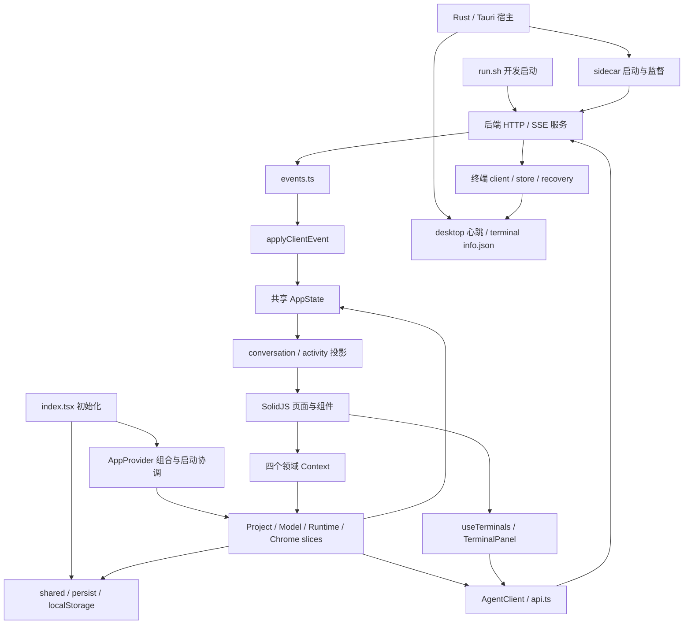

# Coda 架构与代码质量审查（2026-10-18）

状态：本文保留改造前的诊断基线。用户随后已授权全部修复，实施与最终验证见 [修复结果](2026-10-18-results.md)。以下问题描述和代码位置反映审查时的状态。

## 1. 三个问题的结论

1. **整体架构方向合理，结构基本清晰，但尚未达到优秀。** SolidJS UI、状态管理、HTTP/SSE 适配器、Rust 宿主和独立 sidecar 的职责划分成立；未发现前端生产模块的显式运行时导入环。主要问题是跨层副作用、共享可写状态、两套快照同步流程，以及本地源码和发布源码不一致。
2. **设计质量不宜整体评为优秀。** 组合、端口注入、事件处理与纯函数投影已有良好基础，但封装、单一职责、依赖倒置和并发一致性仍有明确缺口。该项目主要采用函数式、响应式和 Effect 服务组合；增加类、继承层级或设计模式数量不能解决这些问题。
3. **存在无效代码和可合并逻辑。** 已确认 7 个无引用函数、1 个无引用类型、2 个仅被测试调用的旧接口，以及未被消费的请求选项。部分旧样式需要视觉复核后才能删除；没有证据支持整包删除上游代码或现有运行依赖。

优先级应是：发布一致性与并发正确性 → 已确认无效代码 → 同步规则和副作用边界 → 更广泛的结构调整。

本报告是限定产品链路的源码审查和自动化验证，不代表完整平台认证或性能评测。没有修改产品实现，也没有把已发现的问题标记为修复。

## 2. 基线与证据边界

| 项目 | 本轮基线 |
| --- | --- |
| 父仓库 | `ec0bc1c3d6f07a51535a8fea3af1065268665a91` |
| backend gitlink / HEAD | `15e63b8d7c45ec78f9c5849e2f2c32b6a9a22f2a` |
| 软件版本 | 客户端约定的四处均为 `1.5.2` |
| 开始时父仓库状态 | 仅 `backend` 工作区为 dirty；此前对话中的前端未提交清单已不适用于当前 HEAD |
| 后端现有改动 | 10 个已跟踪文件修改、8 个未跟踪文件，均保留；文件清单及 SHA-256 见 evidence.json |
| 环境 | macOS arm64；Bun 1.4.3、Node 24.20.0、Rust 1.94.1 |
| 前端静态范围 | 81 个生产 TS/TSX 文件、44 个测试文件；包括字面量动态导入 |

验证结果和原有改动摘要保存在 [evidence.json](./evidence.json)。不读取真实模型凭据，不启动真实用户会话；后端测试使用临时 `CODA_HOME`，现有测试 preload 隔离 XDG 路径和数据库。

| 验证 | 结果 |
| --- | --- |
| 根目录 `bun run test` | 44 个文件，254 项通过 |
| frontend `./node_modules/.bin/tsc --noEmit` | 通过，包含现有 noUnusedLocals / noUnusedParameters 检查 |
| frontend `bun run build` | 通过；ghostty-web 分块约 1,381.79 kB、gzip 424.51 kB，有体积警告 |
| backend/packages/opencode `bun run typecheck` | 通过 |
| 后端 terminal、shell、prompt、tools 四个测试文件 | 96 通过、1 跳过、0 失败；跳过项是未启用的 v2 projector 场景 |
| Rust `cargo fmt --all -- --check` | 通过 |
| Rust `cargo check --locked` / `cargo test --locked` | 通过；5 项单元测试通过 |
| 父仓库、子模块 `git diff --check` | 通过 |
| 五份补丁的有序撤销与重放 | 临时目录中全部通过；25 个相关文件与工作区逐字节一致 |
| 新增独立诊断测试 | 3 项通过，分别复现 A02、A03、A04 的现有错误行为 |

**诊断测试通过表示问题被复现，不表示问题已修复。** 它们没有加入前端常规测试入口；修复时应转化为断言正确行为的回归测试。

未执行完整后端 monorepo 测试、完整 sidecar/安装包构建、实时 GUI 端到端交互、Windows/Linux 运行验证或远端镜像可达性检查。构建体积警告只证明输出大小，不能证明启动卡顿或内存泄漏。

## 3. 当前架构、数据归属与失败处理



这张图包含需要改善的真实依赖：终端绕过 AppPorts，业务 slice 直接访问持久化模块，Rust 与后端共同读写终端记录。

| 链路 | 责任与数据所有者 | 当前失败处理及边界 |
| --- | --- | --- |
| 启动 | Rust 安装原生能力、后台监督 sidecar；index.tsx 先水合设置，再挂载 UI；AppProvider 做健康检查与恢复 | 原生错误记录到日志；前端重试健康检查。健康与业务配置同步未分开，见 A05 |
| 模型配置 | ModelSettings 管理编辑表单；ModelSlice 管理已配置模型；shared/localStorage 保存设置；PATCH global/config 更新后端配置 | 保存同步失败展示 modelSettingsError；启动及跨实例同步存在吞错分支 |
| 发送与排队 | RuntimeSlice 编排；outgoing 持有稳定 message/part ID；AppState 保存草稿、队列及发送状态 | 失败/不确定送达分别展示；重试先查历史，避免重复发送；队列有会话级锁 |
| SSE 与历史快照 | events.ts 管理连接；apply-event 管理事件应用；project-slice 与 session-reconcile 分别读取快照 | revision、事件去重、消息/part tombstone 保护已有状态；会话级删除和迟到响应仍缺失，见 A03 |
| 时间线 | conversation.ts 生成轮次与阶段；activity.ts 生成工具摘要；组件渲染 | 完成状态有集中投影，避免组件各自判断；旧投影接口仍残留 |
| 设置与草稿 | shared 是进程内缓存及脏字段队列；Rust 写 settings.json；localStorage 保存草稿、界面状态与回退值 | 写失败部分被吞掉；跨进程读改写不原子，见 A04；数据不是都由同一份磁盘文件权威管理 |
| 终端任务 | 后端 client 持有 PTY；store 管理日志和元数据；recovery 管理恢复；前端轮询元数据并流式读取输出 | 有界日志、取消、去重与恢复守卫；UI 与磁盘协议各自手写类型，见 A07 |
| 隐藏与退出 | Rust lifecycle 统一处理窗口关闭、菜单退出、快捷键退出、存活心跳和清理 | 活跃任务退出确认、TERM/KILL 清理、后端异常恢复均有实现；本轮未做真实桌面复验 |
| 打包 | pack.sh → Tauri → build-sidecar.sh；CI 从父仓库 gitlink 检出 backend | 当前 clean checkout 不含未提交的终端实现，见 A01 |

## 4. 设计质量评价

评分含义：优秀表示本轮检查范围内边界清晰且有充分验证；合格表示基本成立但有改进点；需改进表示已有具体缺陷或持续维护风险；不适用表示缺乏相应机制，不扣分。

| 维度 | 评价 | 依据 |
| --- | --- | --- |
| 顶层分层与部署 | 合格 | UI / Rust / sidecar 分离合理；发布源码一致性不足（A01） |
| 结构清晰与内聚 | 合格 | components / store / lib 清晰，领域 Context 已拆分；persist 和 RuntimeSlice 承担多种副作用 |
| 封装与低耦合 | 需改进 | StoreHandle 暴露整个可写 AppState，slice 之间没有类型层面的写入所有权；终端直接访问 API |
| 并发与生命周期 | 需改进 | 已有请求代次、revision、tombstone 和队列锁；A02–A04 证明保护尚未覆盖完整生命周期 |
| 单一职责 S | 需改进 | 项目模块同时处理目录选择、列表缓存、快照合并；运行模块同时处理草稿、附件、交互请求、发送和队列 |
| 开闭原则 O | 合格 | 事件处理表与 Effect 服务便于局部扩展；新增设置仍需在多个读写/同步入口维护，不能靠增加模式消除语义工作 |
| 里氏替换 L | 不适用 / 未充分验证 | 没有关键业务继承层次；端口替身能通过测试不等于真实 HTTP、桌面与浏览器适配器行为完全等价 |
| 接口隔离 I | 合格 | 四个 Context 降低 UI 对全局接口的依赖；RuntimeApi 和内部 AgentClient 仍较宽，不应为每个按钮制造新接口 |
| 依赖倒置 D | 需改进 | AppPorts 是良好基础；AgentClient 由具体 API 模块 Pick 得到，存储、文件选择、时钟及终端通信未完整注入 |
| 组合与多态 | 合格 | slice 工厂、可替换端口、Effect 服务组合符合技术栈；没有必要改成类层次 |
| 设计模式使用 | 合格 | Provider、端口适配、事件 reducer、纯函数投影和会话锁都有实际用途；无需引入全局事件总线或通用仓储框架 |
| 可测试性 | 合格 | 核心状态及工具逻辑有行为测试；AppProvider 启动/重连、原生进程监督、跨进程设置一致性缺少直接覆盖 |
| 可维护性与冗余控制 | 需改进 | A06 两套同步策略、D01–D05 旧接口与重复入口增加后续修改成本 |

未发现由显式值导入形成的前端环；包含类型引用时会形成连接 models/shared/persist 等模块的环，这不等于运行时循环。`types.ts`、`contracts.ts`、`ports.ts` 是有效的类型边界，不是死文件。此结论来自静态解析，不覆盖任意运行时字符串构造的加载关系。

## 5. 问题清单与证据

严重程度：P1 阻碍发布/重要能力；P2 可触发的正确性问题或显著维护风险；P3 清理和工程一致性改进。没有将设计偏好认定为 P1。

### A01 · P1 · 发布不能复现本地终端能力（已验证源码与补丁）

- 位置：[release.yml](../../.github/workflows/release.yml) 的子模块检出/构建步骤、[build-sidecar.sh](../../scripts/build-sidecar.sh)、[api.ts](../../frontend/src/lib/api.ts):287、`backend/packages/opencode/src/terminal/`。
- 证据：gitlink 中没有 terminal 目录及终端 API group；本地增加的 18 个文件改动由 managed-terminals.patch 还原。CI 和构建脚本没有应用该补丁的步骤。
- 影响：全新 checkout 即使能成功编译，产出的 sidecar 也缺少前端所请求的终端路由和相应行为。本轮没有远程重跑 CI，不把推断表述成已观察到的安装包故障。
- 建议：优先建立确定性的后端源码准备步骤和必要能力门禁，再进行结构重构。不能让生产构建隐式使用开发者 dirty 子模块。

### A02 · P2 · 过期失败响应覆盖新结果（诊断测试已复现）

- 位置：[project-slice.ts](../../frontend/src/store/project-slice.ts):133–175。
- 调用：启动水合、重连刷新、重新选择项目均可能重叠调用 refreshProjectSessions；成功分支检查 sessionListGen，catch 分支没有检查。
- 场景：同目录较新请求成功后，旧请求返回 ENOENT；现有代码仍将项目标记 missing 并展示“项目文件夹已不存在”。
- 建议：成功和失败共享同一个项目请求令牌；代次与生命周期记录移入 slice 实例，项目移除/重定位时失效。

### A03 · P2 · 删除后的会话状态被迟到快照重新创建（诊断测试已复现）

- 位置：[session-reconcile.ts](../../frontend/src/store/session-reconcile.ts):7–49、[gc.ts](../../frontend/src/store/gc.ts):4、[project-slice.ts](../../frontend/src/store/project-slice.ts):194。
- 调用：idle/reconnect 启动 reconcileSession → 删除会话调用 purgeSession → 旧请求返回。消息/part tombstone 不是会话删除令牌；purgeSession 还会删除 revision 等记录。
- 场景：删除前尚未在本地出现的助手消息迟到，messages/status 又被写入；会话列表仍已删除，但全局活跃状态可能被污染。
- 建议：引入会话生命周期代次，删除时使所有详情/同步请求失效；提交响应前验证代次。不能用“当前是否选中”过滤，因为后台会话仍需同步。

### A04 · P2 · 跨实例设置写入仍可能丢字段（桥接时序测试已复现）

- 位置：[shared.ts](../../frontend/src/lib/shared.ts):146–178、[lib.rs](../../frontend/src-tauri/src/lib.rs):14–36。
- 证据：writeQueue 只在单个 JS 模块实例内串行；读取与写入是两次独立 IPC。两个实例同时读到旧文件后，各自合并自己的 dirty key，最后一次整文件写会覆盖另一实例的不同字段。Rust 还复用同一个 settings.json.tmp。
- 诊断范围：测试使用两个独立 shared 模块实例和受控 IPC 替身复现读改写交错；没有启动两个真实应用进程或修改真实设置。
- 建议：把带锁的“读取最新值 → 合并字段 → 原子替换”放入原生存储边界；原子重命名本身不能保证整个读改写事务原子。

### A05 · P2 · 启动成功标志早于配置同步，失败无法自动补偿（源码证据）

- 位置：[app.tsx](../../frontend/src/store/app.tsx):89–108、174–195。
- 场景：healthcheck 成功立即设置 bootstrapped；随后 PATCH global/config 失败被吞掉。后续启动轮询退出，SSE 重连主要刷新发现列表，不重新补交失败配置。新本地配置与后端配置可能分离。
- 建议：分别记录服务可达和业务初始化结果，配置同步明确成功/待重试/失败；在重连时重试当前配置，不清空用户已经保存的模型。
- 限制：本轮未执行真实 sidecar 的该故障注入；现有测试也没有直接覆盖 AppProvider 启动流程。

### A06 · P2 · 两套会话快照编排与广泛写权限（设计问题）

- 位置：[project-slice.ts](../../frontend/src/store/project-slice.ts):194–307、[session-reconcile.ts](../../frontend/src/store/session-reconcile.ts)、[handle.ts](../../frontend/src/store/handle.ts):16。
- 证据：两条路径均读取消息、状态、权限、问题、Todo，并各自实现请求前快照、合并与删除保护；详情允许部分辅助接口失败，idle 同步是整组成功后推进。业务差异需要保留，合并机制不应复制。
- 影响：修复删除/竞态需要同时修改多个入口；整个 AppState 可写使所有权难以审查。文件行数只是定位线索，不是问题成立的依据。
- 建议：抽出一次快照采集/合并协议与共享纯规则，由“详情加载”和“结束同步”保留各自失败策略；集中会话生命周期写入，保持原有响应式模型。

### A07 · P2 · 终端接口绕过端口，跨语言记录协议缺少明确边界（设计问题）

- 位置：[terminals.ts](../../frontend/src/lib/terminals.ts):4、[TerminalPanel.tsx](../../frontend/src/components/TerminalPanel.tsx):4；后端 `terminal/store.ts`、HTTP `groups/terminal.ts`；[lifecycle.rs](../../frontend/src-tauri/src/lifecycle.rs):228–289、358–378。
- 证据：终端直接使用具体 API 和 fetch；前端手写 TerminalInfo/TerminalLog，HTTP 成功体使用 Schema.Unknown；Rust 用 serde_json::Value 读取并修改后端 info.json。
- 影响：现有 AppPorts 替身无法替换整个会话页面的终端通信；字段变更可能只在运行时暴露。未据此推断当前存在具体字段不兼容或进程误杀。
- 建议：增加独立 TerminalClient 端口，把列表/控制/日志/输出流收进适配器；明确终端 HTTP 和持久记录的消费契约，增加跨语言 fixture 验证，保留原生崩溃兜底。

### A08 · P3 · 文档和验证入口漂移（源码证据）

- README 写当前版本 1.0.0，根 package.json 是 1.1.0，四处发布版本是 1.5.2；根 package.json 不属于 AGENTS 要求同步的四处，因此前者是元信息漂移，不是四处版本违规。
- ci-should-pack.sh 检查三处版本，没有检查 Cargo.lock 中的 coda 版本；当前四处恰好一致。
- frontend 的 build 只执行 vite build，类型检查目前依赖人工单独运行；测试性能提示显示 jsdom 为每个文件创建环境，但没有足够数据支持直接关闭测试隔离。
- 建议：统一版本信息来源/门禁；提供一个本地验证入口，保留“CI 打包不跑测试”的既有约定。

### A09 · P3 · 品牌兼容边界未收口（源码证据）

- [api.ts](../../frontend/src/lib/api.ts):42 已发送 x-coda-directory；但 [backend.rs](../../frontend/src-tauri/src/backend.rs):100–103 仍由 Coda 启动器发出 OPENCODE_* 环境变量，run.sh:208 仍显式使用上游品牌 User-Agent。
- 这与根 AGENTS 对“自有发送端只使用新名”的目标有差距，但当前后端仍消费这些旧名，不能直接全局替换。上游内部包名与入口名称也尚未全面适配。
- 建议：单列兼容适配批次，在后端边界接受 Coda 新名并保留旧名读取，再迁移自有发送端；内部 workspace 包路径迁移另行评估，不纳入死代码删除。

## 6. 无效代码、重复代码与保留清单

判定方式：TypeScript AST/符号引用扫描后，逐项用生产入口、命名空间注入、动态导入、模板和构建入口交叉验证。API 函数通过 `client: api` 整体注入，不能因没有逐函数直接调用就判为未使用。

| 编号 / 分类 | 项目与位置 | 证据与处理 |
| --- | --- | --- |
| D01 / 可删除 | activity.ts:33 splitProcessAndAnswer、:50 isWorkLive、:501 stepBody、:540 formatWorkedFor | 生产与测试均无引用；现有时间线使用 conversation 投影，工具正文在 WorkGroup 中处理。只删除这些已确认入口和随之不可达的私有声明，保留仍使用的 activity 摘要能力 |
| D02 / 可删除 | models.ts:240 updateConfiguredModel；settings.ts:17 sendShortcutLabel | 生产与测试均无引用；当前编辑走 provider 批量配置，设置 UI 自己显示实际快捷键选项 |
| D03 / 可删除 | draft.ts:6 DraftBundle、:11 emptyDraft；api.ts:82 expectJson 请求选项 | 前两项全仓无消费；expectJson 从未读取或传入。draftKey、persist 中有用的 DraftBundle 和 state 中 emptySessionDraft 必须保留 |
| D04 / 可替换后删除 | activity.ts:22 groupActivityBlocks、:496 stepLabel | 仅 activity.test.ts 使用。groupActivityBlocks 已被生产 conversationBlocks 替代；stepLabel 是 stepPresentation 的旧文字拼接入口。先把仍有价值的断言迁到实际生产接口，再移除旧接口和专属测试 |
| D05 / 可合并 | project-slice 与 session-reconcile 的快照合并；remote-models.ts:8 与 platform.ts 的 isTauri | 前者按 A06 合并共享机制；后者合并到现有平台适配入口。settings 中的平台判断应移到不依赖设置存储的底层模块，避免反向依赖 |
| D06 / 待确认样式 | global.css 的 tool-card/head/name/title/status/body、compaction-live/body、working、field-note、spinner、work-summary-action/detail | 未找到生产字面量类名引用，疑似旧 UI 残留。须检查动态/第三方生成 DOM，再对时间线、压缩、模型设置、明暗主题做前后截图比对，才可删除；不将静态扫描结果直接算作已确认死样式 |
| K01 / 必须保留 | TerminalPanel 的 default export | SessionPage:17 使用 lazy 动态导入；只搜索具名引用会误报 |
| K02 / 必须保留 | logo.svg、fontawesome-webfont.ttf、hljs-* / function_ 高亮样式 | 分别由 index.html、global.css 与 highlight.js 生成的 HTML 使用；ttf 也只是初步 CSS 正则扫描中的文件后缀误报 |
| K03 / 必须保留 | 旧字段清理、旧目录迁移、平台条件编译、Tauri 命令注册、类型专用模块 | 旧数据兼容与平台入口仍有效；不能因当前新配置/当前 macOS 路径未触发就删掉 |
| K04 / 必须保留 | 上游 TUI/MCP/Web/Console 相关包及注册代码（本轮不删） | packages/opencode/src/index.ts 与服务图仍有静态依赖；“Coda 不提供该产品能力”不等于“依赖图可安全删除”。检查产品暴露与裁剪可行性应独立进行，不能恢复这些能力 |

依赖审查未确认可安全移除的直接生产依赖：plugin-http 用于原生模型目录请求，opener 用于链接，dialog 用于文件交互，notification 用于桌面通知，ghostty-web 动态加载终端，marked/DOMPurify/highlight.js 服务于 Markdown，UnoCSS 是构建插件。`@types/dompurify` 是否冗余应在独立依赖安装和类型检查中验证，本轮列为待确认。

## 7. 建议目标架构与接口变化

保留 SolidJS + Tauri + sidecar，采用组合式结构；不更换状态库，不引入通用框架，不改变现有用户交互与 HTTP/SSE 路径。

- **组合根**：AppProvider 只组装依赖、安装订阅和启动协调；健康、初始化与重连补偿由专门的启动协调逻辑负责。
- **会话领域**：会话同步协调器拥有请求代次、失效和快照合并；发送与队列编排调用它。执行状态、送达状态、交互阻塞分别建模，避免把可同时成立的状态强行合成单一枚举。
- **存储与平台边界**：纯规则依赖领域类型；业务编排依赖明确的 client/settings/project-files 端口；具体 fetch、Tauri、localStorage、窗口与时钟实现只在适配层出现。
- **状态所有权**：保留底层响应式 AppState，按领域提供只读查询和有限写入操作，逐批收紧 StoreHandle；不一次性搬动所有字段。
- **终端边界**：独立 TerminalClient 包含列表、控制、日志和流订阅；组件负责展示与交互，不解析 HTTP/SSE 帧。后端 PTY 和原生清理保留独立职责。

拟议接口变更（均待阶段四审核）：

| 接口 | 变化与兼容约束 |
| --- | --- |
| AppPorts / AgentClient | 从具体 api 模块的 Pick 转为用例需要的领域契约；分离终端和平台/存储端口，保留现有 Context 的使用方式 |
| 新原生命令 settings_patch | 接受字段补丁；原生在共享锁中读最新文件、合并、原子替换，返回成功/明确错误；保留未知字段并按既有规则剔除退役字段，不增加用户数据迁移 |
| 会话请求令牌 | 内部按 session/project 生命周期分配和失效；所有成功及失败回调验证同一令牌，不影响线上 API |
| Terminal HTTP / 磁盘记录 | 给当前消费字段补充显式结构及兼容 fixture，沿用现有路径、字段和值；适用生成代码按后端目录约定生成，不手改生成目录 |
| Coda 环境变量 | 后端同时接受新旧名，自有启动器改发新名；旧用户配置读取仍兼容。该批单独审核，不机械重命名整个上游 monorepo |

## 8. 待审核的实施批次

| 批次 | 范围、实施决策 | 验收与回退 |
| --- | --- | --- |
| B0 发布一致性（A01） | 沿用现有定制后端 gitlink + 公开镜像机制。先增加只读门禁，检查必需终端能力是否存在于钉住的提交，并在临时目录验证补丁系列；不让正式构建默默依赖 dirty 工作区。消除差异需要把已审核后端改动形成提交、镜像同步并更新父 gitlink，这一步需另行授权提交/推送，本轮不执行 | 授权整合后，不含开发工作区的干净构建仍提供 terminal 路由，父 gitlink 对应 SHA 可从镜像获取；不增加构建时重复打补丁的第二条发布路径。整合前门禁明确报错，不能标记发布就绪。门禁可独立回退，后端提交和父指针应配套回退 |
| B1 正确性（A02–A05） | 先将 3 个诊断场景转成正确行为断言；项目成功/失败统一令牌；会话删除统一失效；settings_patch 使用 Rust 标准文件锁配合唯一临时文件，锁内合并；启动配置同步独立重试 | 新结果不被旧失败覆盖，删除后不再写回，双实例不同字段均保留；初始化失败可恢复且不重复发送消息。设置损坏/权限不足明确失败，不覆盖原文件。回退按独立问题补丁处理，不混入结构搬迁 |
| B2 无效代码（D01–D04，A08） | 删除确认无引用项；迁移测试到生产接口再删旧接口。统一版本文档与本地检查入口，增加四处版本一致性校验；保留 CI 不跑测试的约定 | 全量测试、类型、构建通过；不通过删除有价值断言降低测试标准；每个删除项可单独恢复。D06 样式仅在视觉验收完成后纳入 |
| B3 同步和端口边界（A06–A07，D05） | 先抽取共享快照机制，再迁移两个调用入口；保留详情部分失败容忍与 idle 完整同步要求。终端改走独立端口，收紧写状态接口，平台检测移到无存储依赖的模块 | 旧的流式/历史、删除、权限、Todo、重连、队列场景全部通过；交互和 HTTP 路径不变；每迁移一个入口均复审，可回退到前一适配器 |
| B4 协议与兼容收口（A07、A09） | 增加终端记录跨语言 fixture 和消费字段校验；把 Coda 品牌别名适配放在明确的后端入口，再迁移自有发送端；不裁剪上游整包 | 新旧配置均可启动，自有请求/环境变量符合 Coda 命名，终端退出/恢复记录可互读；相关后端行为改动更新补丁及登记。内部包路径大迁移不默认执行 |

本次仅形成审核材料，不执行 B0–B4。批次获得审核后，每批执行“审查 → 修复 → 验证 → 重新审查”；默认不升级版本、不 commit、不 push、不发布。B0 的提交态整合是明确的后续发布前置条件；没有相应授权时仅准备可审查的改动与验证结果，不自动提交，也不宣称已解决发布一致性。

## 9. 批次验收场景与完成标准

- 前端每批执行全量测试、类型检查、生产构建及 diff 检查；Rust/后端变更追加相关格式、锁定依赖检查、包级类型和受影响行为测试。
- 并发：A/B 项目切换、同项目乱序成功/失败、会话删除后迟到成功/失败、同时 SSE 与历史快照、同会话同步去重、不同会话独立推进。
- 送达：正常、明确失败、不确定送达、SSE 确认后 HTTP 丢失、原 ID 重试、队列立即发送和停止；确保不会重复执行模型请求。
- 初始化和存储：sidecar 启动延迟、配置 PATCH 失败后重连、多实例同时修改不同/相同设置字段、写入失败、旧设置迁移。不同字段不丢；相同字段以锁内提交顺序为准。
- 桌面与终端：真实发布构建的启动、运行中关闭/恢复窗口、退出取消与确认、后端异常、任务取消、只停止 AI、只读输出与 UTF-8 日志游标；使用独立 CODA_HOME。
- 视觉：时间线正常/失败/压缩/工具展开、模型设置、终端、明暗主题；删除旧样式前后对比。
- 结构复审：共享合并机制只有一个来源，类型和运行时依赖方向清晰，终端可注入替身，清理后不存在为遗留接口而保留的测试。

只有上述影响范围内的检查和复审完成，才可将对应批次标记完成。无法实测的平台必须写明，不把 macOS 构建或单元测试结果表述为跨平台验证通过。

## 10. 诊断测试转回归后的重跑

原独立诊断现已转为断言修复行为的常规回归测试，并扩展覆盖停止、回滚、重试与写入失败。在仓库根目录执行：

```bash
bun run --cwd frontend test --run src/store/architecture-regression.test.ts
```

测试调用真实的 project-slice、session-reconcile、purgeSession 和 shared 实现；网络/IPC 使用确定性替身，测试数据全部为虚构值。它们只验证报告所列故障时序，不替代安装版交互测试。
